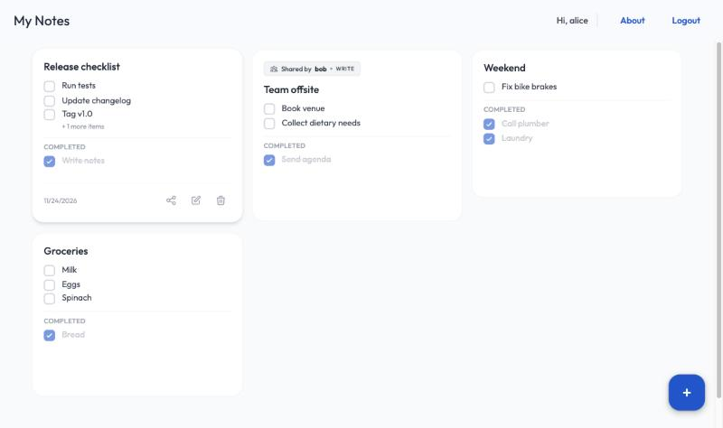
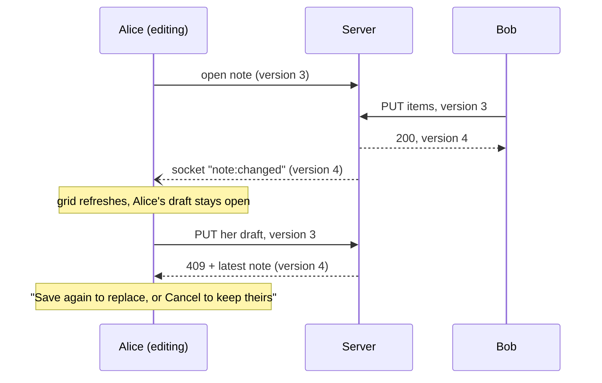

# Todo Notes

[](https://github.com/RAZORRZR0/Todo_App/actions/workflows/ci.yml)

Collaborative checklist notes with live sync, edit-conflict detection, image attachments and per-user sharing. Express 5, MongoDB and Socket.IO on the backend, plain JavaScript and Tailwind on the frontend.

Built during an internship at NHPC.



## Features

- **Checklist notes.** Each note has a title and items you can tick off. Completed items move to their own section.
- **Images on items.** Attach PNG, JPEG, GIF or WebP images (5 MB max) to any item.
- **Sharing.** Share a note with another user as **read** or **write**. Only the owner can share or delete it.
- **Live sync.** When anyone saves, shares or deletes a note, everyone who can see it gets the change over Socket.IO, with no refresh.
- **Conflict detection.** Two people editing the same note can't silently overwrite each other (details below).
- **Guest mode.** Without an account, notes are kept in the browser's localStorage.
- **Admin panel.** Admins can list users and delete them, along with their notes.
- **Mobile layout.** Bottom bar, menu and floating add button on small screens.

## How live sync and conflicts work



- Each note has a `version` that goes up by one on every save. `PUT /api/notes/:id` must send the version the client started from.
- The server does a single compare-and-set: `findOneAndUpdate({ _id, version }, { $set, $inc: { version: 1 } })`. If someone saved first, nothing matches and the client gets **409** with the current note. There's no read-then-write gap, so of 5 simultaneous saves from the same version exactly one wins (a test checks this).
- After a save, the server emits `note:changed` to a Socket.IO room per user, covering the owner and everyone the note is shared with. The sender's own socket is skipped using an `X-Socket-Id` header. Sockets authenticate with the same JWT as the API.
- In the browser, quick checkbox clicks on one note are queued so each save uses the version the previous one returned. Otherwise a fast double-click would conflict with itself.

## Security

- Passwords are hashed with bcrypt. Login is throttled to 5 failures per 5 minutes per IP and username.
- JWTs are signed with `JWT_SECRET`. There is no hard-coded fallback: if the secret is unset, each run makes a random one.
- Every request body is validated before it reaches MongoDB. Usernames and IDs must be strings, so `{"$ne": null}` style injection is rejected, and only known note fields are stored.
- Note text is escaped before rendering, so a shared note can't run script in the other user's browser.
- Uploads are checked by MIME type and size. The server picks the file name and extension, so a `.html` or `.svg` file can't be served from the app.
- Admin user lists never include password hashes, and server errors never send internals to the client.

## Run it

Needs Node 20+ and MongoDB.

```bash
npm install
cp .env.example .env          # set JWT_SECRET
npm start                     # http://localhost:3000
```

Create an admin account:

```bash
npm run create-admin -- <username> <password>
```

`share.sh` opens a temporary public URL for your local server through Cloudflare Tunnel. It installs `cloudflared` with Homebrew if it's missing.

## Tests

```bash
npm test                      # needs MongoDB on 127.0.0.1:27017, or set MONGO_URL
```

The 9 API tests cover:

- registration rules
- login injection and lockout
- token checks
- note CRUD and validation
- read/write sharing rules
- admin role checks and cascading delete
- upload type and size limits
- version conflicts, including a 5-way race
- socket auth and who receives live updates

GitHub Actions runs them on every push against a MongoDB service container.

## API

| Method | Path | Notes |
|---|---|---|
| POST | `/api/auth/register` | `{ username, password }` |
| POST | `/api/auth/login` | Returns `{ token, username, role }` |
| GET | `/api/notes` | Your notes plus notes shared with you |
| POST | `/api/notes` | `{ title, items: [{ text, is_done, images }] }` |
| PUT | `/api/notes/:id` | `{ title, items, version }`, owner or write access. 409 if `version` is stale |
| DELETE | `/api/notes/:id` | Owner only |
| POST | `/api/notes/:id/share` | `{ username, permission: "read" \| "write" }`, owner only |
| GET | `/api/users` | Usernames for the share picker |
| POST | `/api/upload` | multipart `image`, returns `{ url }` |
| GET / DELETE | `/api/admin/users[/:id]` | Admin only |

## Layout

```
server.js                 routes, upload handling, login throttle
src/config.js             environment settings
src/validate.js           request body validation
src/realtime.js           Socket.IO auth, per-user rooms, change notifications
src/db/                   Mongoose connection and schemas
src/repositories/         data access for users and notes
src/middleware/           JWT auth and admin check
public/                   frontend (index.html, app.js, about.html)
scripts/create_admin.js   create or promote an admin
test/api.test.js          API tests (node:test)
```

## Limitations

- The login throttle and Socket.IO rooms are in memory, so they only work with a single server process. Running several would need Redis (rate limits plus the Socket.IO Redis adapter).
- Conflicts are detected per note, not merged per item: the second saver chooses to overwrite or discard.
- Uploaded images are public to anyone who knows the URL. File names are random, but there is no per-note access check.
- Tailwind is loaded from its CDN, which is meant for development. A production build would compile the CSS.
